<div align="center">

<picture>
  <source media="(prefers-color-scheme: light)" srcset="https://raw.githubusercontent.com/erenthedeveloper0/cindervale/main/brand/social/cindervale-banner-light.jpg">
  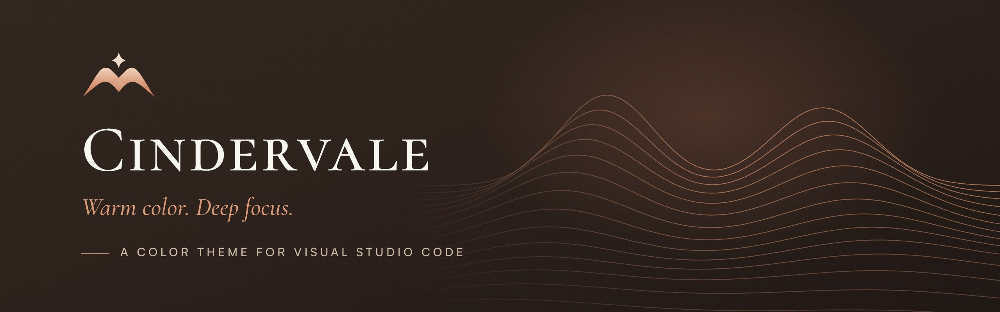
</picture>

<h3>A warm color theme for Visual Studio Code</h3>

Four variants from one palette: Cindervale Dark and Light, and the color-vision-aware<br>
Accessible Dark and Accessible Light. Warm paper and charcoal, measured contrast, no neon.

[](https://github.com/erenthedeveloper0/cindervale/actions/workflows/ci.yml)
[](CHANGELOG.md)
[](https://marketplace.visualstudio.com/items?itemName=erenthedeveloper0.cindervale-theme)
[](package.json)
[](LICENSE)

[Visual Studio Marketplace](https://marketplace.visualstudio.com/items?itemName=erenthedeveloper0.cindervale-theme) · [Accessibility](docs/accessibility.md) · [Customization](docs/customization.md) · [Changelog](CHANGELOG.md) · [Contributing](CONTRIBUTING.md)

</div>

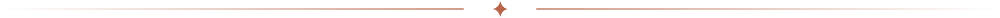

<table>
  <tr>
    <td width="50%">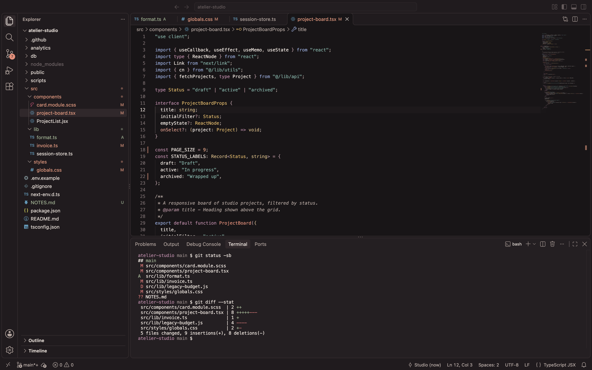</td>
    <td width="50%">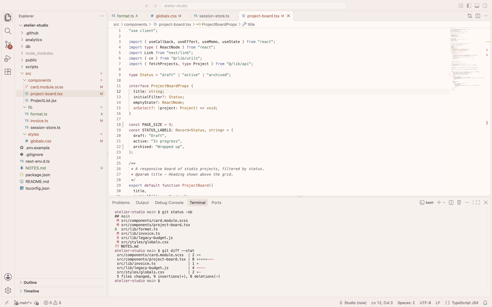</td>
  </tr>
  <tr>
    <td><b>Cindervale Dark</b><br><sub>Warm charcoal and walnut, copper and burgundy light, ivory type</sub></td>
    <td><b>Cindervale Light</b><br><sub>Warm ivory paper, terracotta and soft wine, sage and muted blue</sub></td>
  </tr>
  <tr>
    <td>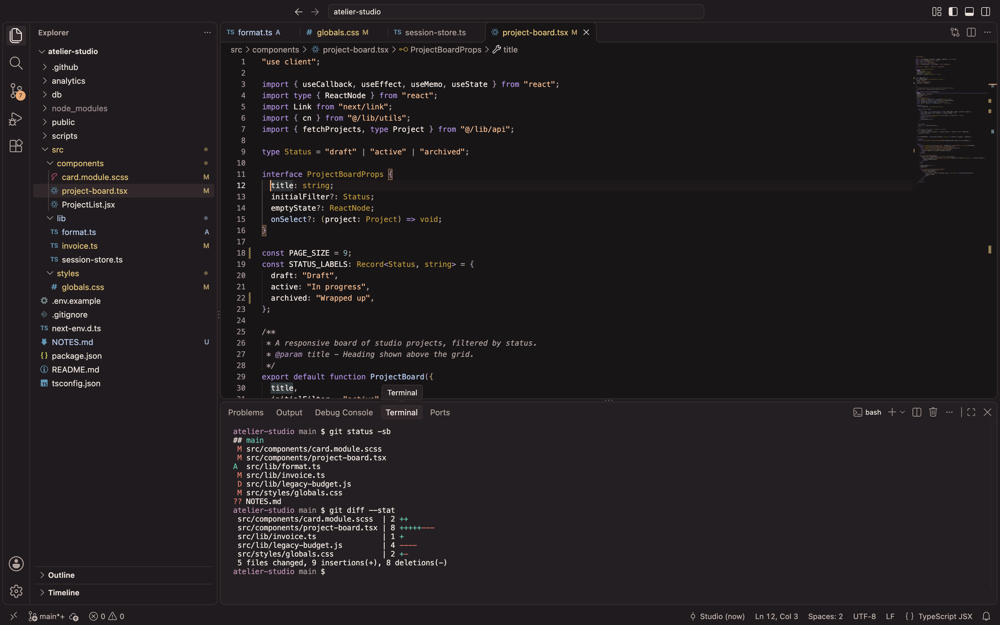</td>
    <td>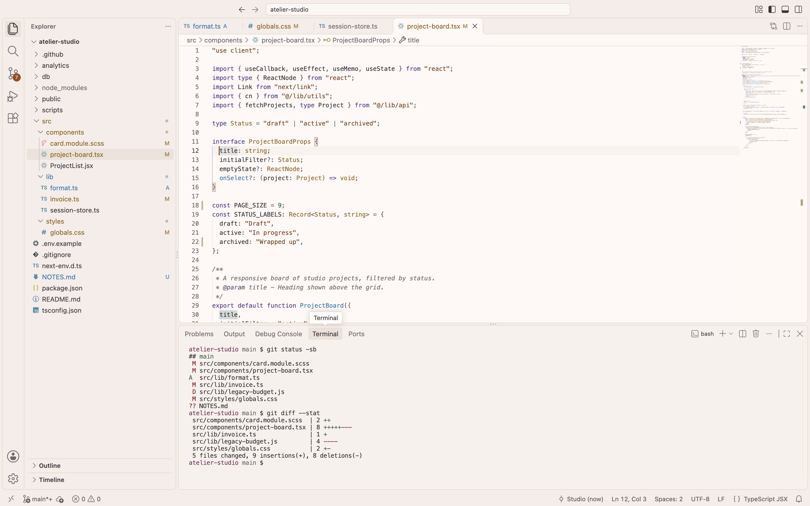</td>
  </tr>
  <tr>
    <td><b>Cindervale Accessible Dark</b><br><sub>The same charcoal, with violet, sky blue, bronze, peach and teal</sub></td>
    <td><b>Cindervale Accessible Light</b><br><sub>The same paper, with deep violet, cobalt, ochre, rust and teal</sub></td>
  </tr>
</table>

```sh
code --install-extension erenthedeveloper0.cindervale-theme
```

Then run **Preferences: Color Theme** (<kbd>Ctrl</kbd>/<kbd>Cmd</kbd> + <kbd>K</kbd>, <kbd>Ctrl</kbd>/<kbd>Cmd</kbd> + <kbd>T</kbd>) and pick one of the
four. Every editor image in this README is a capture from VS Code, not a mockup.

**Contents**: [The idea](#the-idea) · [The accessible variants](#the-accessible-variants) · [Palette](#palette) ·
[Gallery](#gallery) · [What is styled](#what-is-styled) · [Install](#install) · [Settings](#settings) ·
[Development](#development) · [Layout](#layout) · [Documentation](#documentation) · [Contributing](#contributing)


## The idea

> Warm color. Deep focus.

Most of a working day is spent reading code, so Cindervale treats the editor as a page: warm ivory
paper or warm charcoal, never pure white or pure black, with text at high contrast (15.2:1 in the
dark themes, 13.0:1 in the light ones) and color reserved for meaning. A small set of hues repeats
across every language, so a React component, a stylesheet and a `package.json` read the same way.
Punctuation stays quiet and comments are set in a warm italic, so the code itself carries the page.

The mark says the same thing as the name: two ridges with a vale between them, and a spark above
it. In the editor the vale is the page, and the spark is whatever is active. A single warm accent
marks the cursor, the active tab, badges and primary buttons, in every variant.


## The accessible variants

The original palette leans on coral, eucalyptus, berry and sage. Under simulated color vision
deficiencies, several of its roles move very close together: strings and comments, functions and
numbers, and the colors for added, modified and deleted files. **Cindervale Accessible Light** and
**Cindervale Accessible Dark** keep Cindervale's surfaces and neutrals but use a separate set of
colors, chosen and measured so that roles which sit side by side stay apart under simulated
protanopia, deuteranopia and tritanopia:

- **Five syntax accents, separated by lightness as well as hue.** Violet keywords, blue functions,
  ochre types, ember strings, teal numbers. Variables keep the text color, constants are **bold**,
  comments *italic*.
- **One meaning per interface accent.** Blue is focus, information and additions; ochre is find,
  warnings and modifications; berry is errors; ember marks what is active. Red never has to be told
  apart from green.
- **Firmer contrast.** Every syntax color reads at 4.5:1 or more on the editor and the current line,
  line numbers and secondary labels at 4.5:1, and focus rings, input outlines and checkboxes at 3:1.

<table>
  <tr>
    <td width="50%">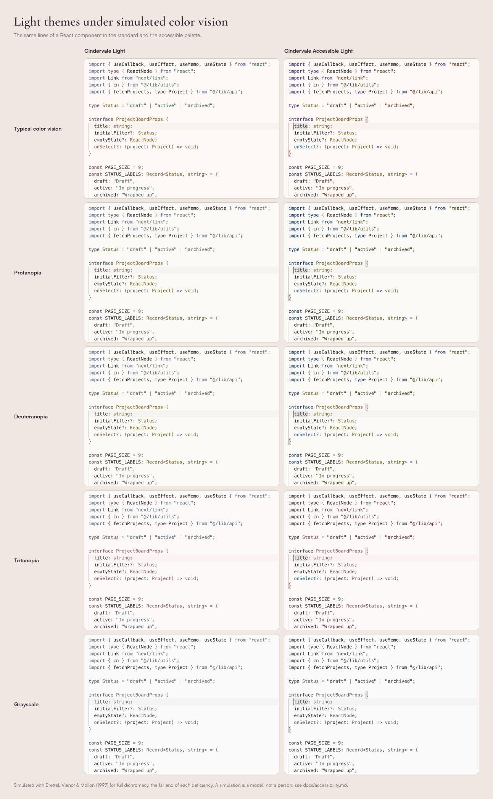</td>
    <td width="50%">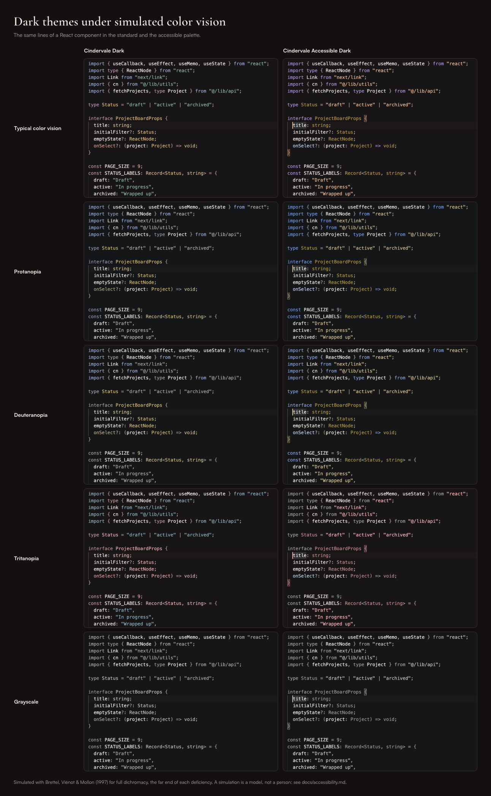</td>
  </tr>
  <tr>
    <td colspan="2"><sub>The same lines of a React component in the standard and accessible variants, captured in VS Code and run through the audit's simulation pixel by pixel.</sub></td>
  </tr>
</table>

Color vision varies from person to person, and simulations are models, not people: no theme can
promise that every color works for everyone. [docs/accessibility.md](docs/accessibility.md)
describes what was measured, the method, the results (including where the accessible palette is
*closer* than the original) and what still needs testing with people. If two colors are hard for
you to tell apart, please [report it](https://github.com/erenthedeveloper0/cindervale/issues/new/choose).


## Palette

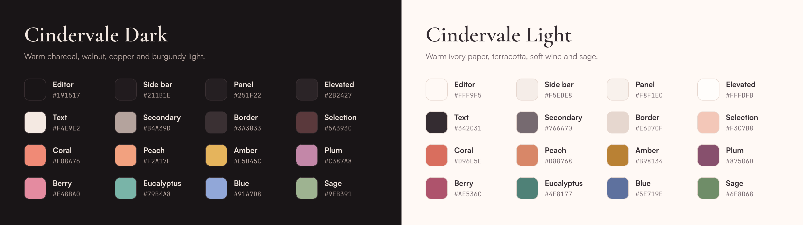

| Color | In code | In the interface |
| --- | --- | --- |
| **Coral** | functions, methods, React components | cursor, focus, badges, primary buttons |
| **Plum** | keywords, tags, JSON and YAML keys, CSS selectors | symbol references |
| **Amber** | types, classes, interfaces, attributes | search matches, warnings |
| **Eucalyptus** | strings, CSS values, inline code | hints |
| **Blue** | `import` / `export`, namespaces, CSS properties, links | information, peek views |
| **Berry** | constants, enums, CSS custom properties | removed lines, breakpoints |
| **Peach** | numbers, booleans, regular expressions | — |
| **Sage** | added lines in diff files | added and untracked files, passing tests |

The swatches show the source values. In Cindervale Light, the lighter accents are printed a little
deeper when they are used as text (same hue and chroma, lower lightness), so they read comfortably
on the ivory page.

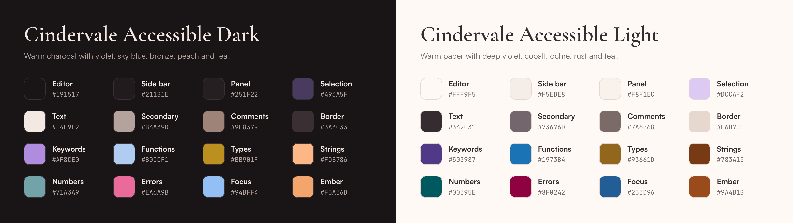

| Role | Accessible Light | Accessible Dark | In the interface |
| --- | --- | --- | --- |
| **Keywords**, tags, keys | deep violet `#503987` | soft violet `#AF8CE0` | selection, debugging |
| **Functions**, methods, components, links in Markdown | blue `#1973B4` | pale blue `#B0CDF1` | information, additions, passing tests |
| **Types**, classes, attributes, Markdown headings | ochre `#93661D` | bronze `#BB901F` | warnings, modifications, find |
| **Strings**, CSS values, inline code | rust `#783A15` | peach `#FDB786` | — |
| **Numbers**, booleans, `null` | deep teal `#00595E` | muted teal `#71A3A9` | hints, symbol references |
| **Constants**, enum members | text, **bold** | text, **bold** | — |
| **Comments** | warm taupe, *italic* | warm taupe, *italic* | — |
| **Errors** | berry `#8F0242` | rose `#EA6A9B` | errors, deleted files |
| **Ember** | `#9A4B1B` | `#F3A56D` | cursor, active tab, buttons, badges |
| **Focus** | `#235D96` | `#94BFF4` | focus rings, links |

Pairs that share a hue family under a color vision deficiency are kept a full lightness tier apart.
In Accessible Light, keywords, strings and numbers are deep tones and functions and types mid tones;
in Accessible Dark, functions and strings are the bright tier and keywords, types and numbers the
softer one.

## Gallery

<table>
  <tr>
    <td width="50%">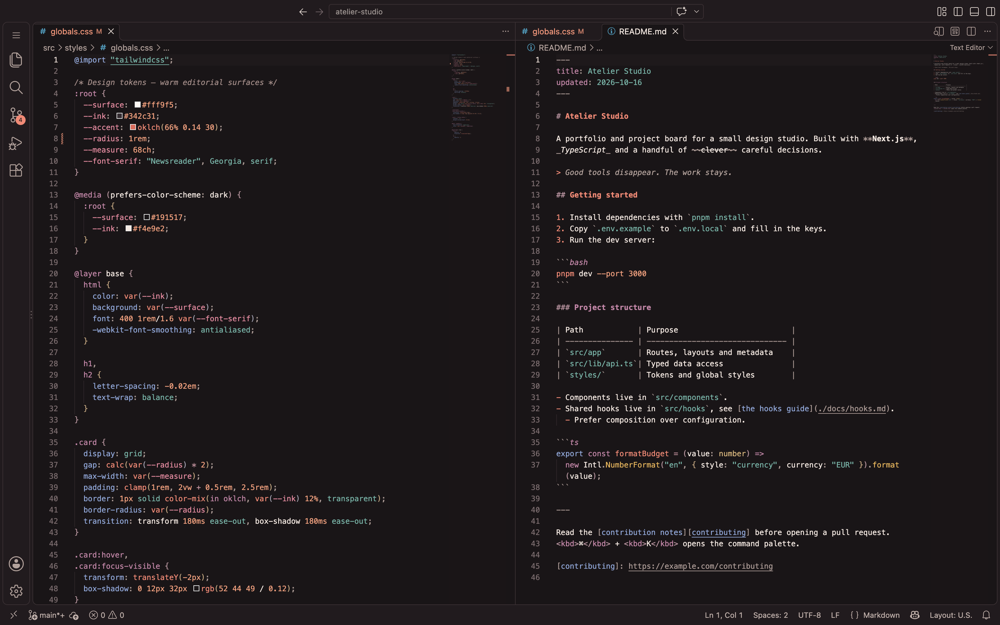<br><sub>Cindervale Dark · CSS beside Markdown</sub></td>
    <td width="50%">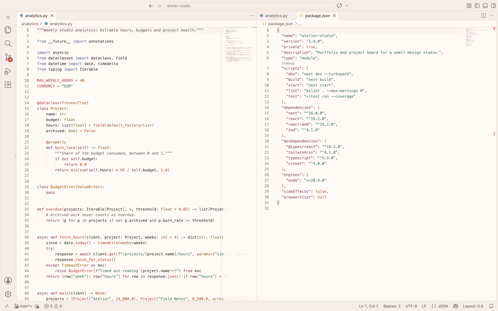<br><sub>Cindervale Light · Python beside JSON</sub></td>
  </tr>
  <tr>
    <td>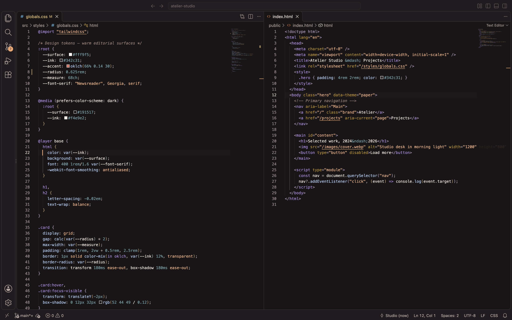<br><sub>Accessible Dark · CSS beside HTML</sub></td>
    <td>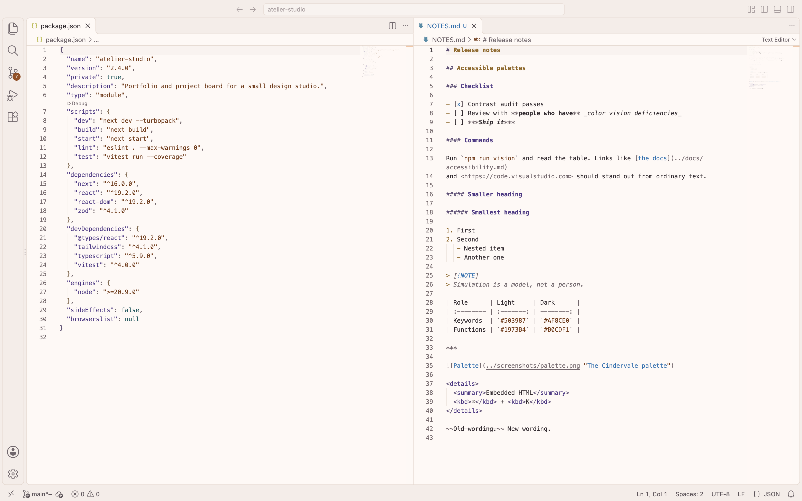<br><sub>Accessible Light · JSON beside Markdown</sub></td>
  </tr>
  <tr>
    <td>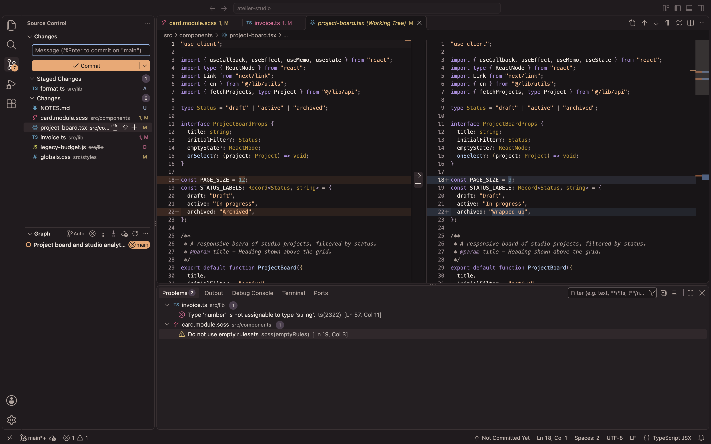<br><sub>Accessible Dark · Source Control, a diff and Problems</sub></td>
    <td>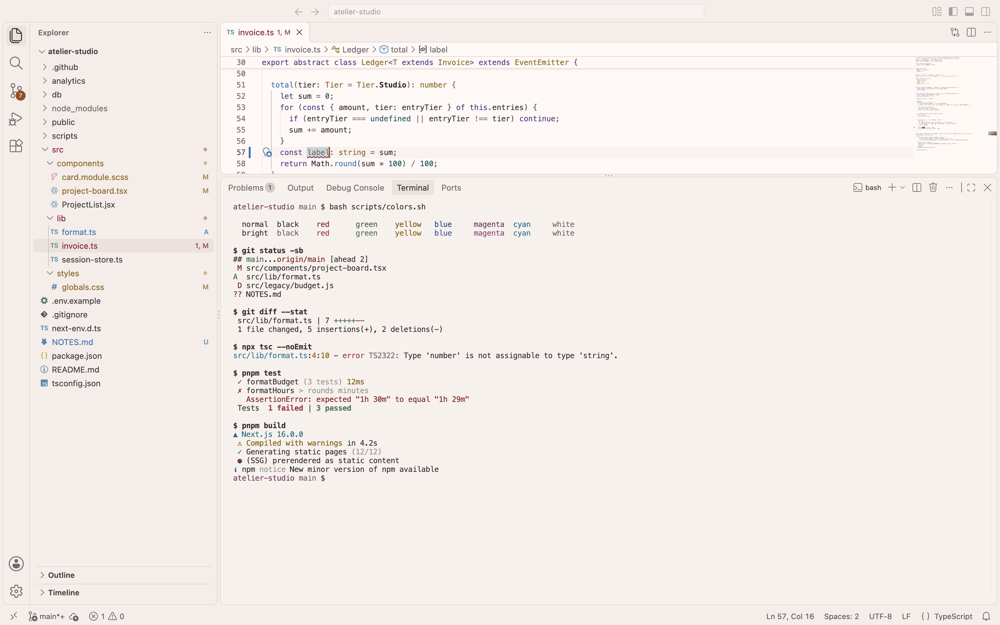<br><sub>Accessible Light · a type error and the terminal palette</sub></td>
  </tr>
</table>


## What is styled

- **The whole workbench:** side bar, tabs, status bar, command palette, menus, notifications,
  settings, Source Control, debugging, testing, notebooks and chat.
- **Semantic highlighting** aligned with the TextMate colors, so code keeps its color when a
  language server attaches.
- **Warm 16-color terminal palettes**; in the accessible variants, red and green stay apart.
- **Git decorations, diagnostics,** and diff and merge editor colors.
- **Bracket pairs, indent guides** and a quiet minimap.
- **Languages** tuned and checked with fixtures: TypeScript, JavaScript, React, Next.js, HTML, CSS,
  SCSS, Markdown, JSON, YAML, Python, SQL, shell scripts, Go, Rust, Java, C#, C/C++, PHP, Vue and
  Svelte.

The extension contains the four theme files and nothing that runs.

## Install

1. Open the Extensions view (<kbd>Ctrl</kbd>/<kbd>Cmd</kbd> + <kbd>Shift</kbd> + <kbd>X</kbd>) and search for **Cindervale**,
   or open [Cindervale on the Visual Studio Marketplace](https://marketplace.visualstudio.com/items?itemName=erenthedeveloper0.cindervale-theme).
2. Select **Install**.
3. Run **Preferences: Color Theme** and choose **Cindervale Dark**, **Cindervale Light**,
   **Cindervale Accessible Dark** or **Cindervale Accessible Light**.

From a terminal: `code --install-extension erenthedeveloper0.cindervale-theme`. The accessible
variants are included from version 1.1.0, and VS Code 1.75 or later is required.

To try a build from this repository instead, run `npm install && npm run package` and install the
generated `.vsix` with **Extensions: Install from VSIX…**.

## Settings

Let VS Code follow your operating system between a dark and a light variant, and mark modified tabs:

```jsonc
{
  "window.autoDetectColorScheme": true,
  "workbench.preferredDarkColorTheme": "Cindervale Dark",     // or "Cindervale Accessible Dark"
  "workbench.preferredLightColorTheme": "Cindervale Light",   // or "Cindervale Accessible Light"
  "workbench.editor.highlightModifiedTabs": true
}
```

Comments render best with a font that has a true italic, and constants in the accessible variants
with one that has a true bold, such as JetBrains Mono, Cascadia Code or Monaspace.

[docs/customization.md](docs/customization.md) has recipes for
[turning italics off](docs/customization.md#turn-off-italics),
[turning bold constants off](docs/customization.md#turn-off-bold-constants), and
[changing an interface color](docs/customization.md#change-an-interface-color) or
[a syntax color](docs/customization.md#change-a-syntax-color) for one variant only.


## Development

The theme files are generated from the palettes in `src/` and checked by tests. Node.js 22 or later.

```sh
npm install
npm run build          # regenerate themes/*.json from src/
npm test               # manifest, schema, color IDs, contrast, color vision, documentation
npm run contrast       # full contrast report
npm run vision         # full color-vision report
npm run tokens         # fixture tokens against VS Code's own grammars (needs VS Code)
npm run package:check  # what the VSIX would contain
npm run package        # build the VSIX
```

### What the checks cover

| Check | What it proves |
| --- | --- |
| `npm run check` | The four theme files are exactly what `src/` generates |
| `npm test` | Unique names and the published registrations, valid colors and font styles, every workbench color ID registered by VS Code, no scope in two rules, no bold through semantic fallback, the contrast and color-vision targets, and that the documentation's links and recipes match the themes |
| `npm run contrast` | 890 foreground and surface pairs across the four themes, translucent overlays composited first; every pair with a target meets it |
| `npm run vision` | 59 role pairs in each accessible variant stay apart under simulated protanopia, deuteranopia and tritanopia (Brettel 1997, CIEDE2000) |
| `npm run tokens` | 254 fixture tokens resolve to their intended role and font style with VS Code's own TextMate engine and grammars |
| `npm run package:check` | The VSIX holds the four themes and the Marketplace files, and nothing from development |

CI runs every one of them on each push, with `npm run tokens` against the latest stable VS Code.

## Layout

```text
src/          the palettes and the rules that generate every theme
themes/       the four generated theme files (never edited by hand)
test/         tests, contrast and color-vision pairs, token expectations, VS Code color IDs
scripts/      build, audits, token inspector, package check, screenshots, brand assets
fixtures/     sample files in every supported language, for visual and token checks
screenshots/  captures from VS Code, palette sheets and color-vision boards
docs/         accessibility notes and customization recipes
brand/        the identity: logo, banners, social preview and its guidelines
images/       the Marketplace icon
```

Only `package.json`, `README.md`, `CHANGELOG.md`, `LICENSE`, `images/icon.png` and the four files in
`themes/` ship in the VSIX.

## Documentation

- **Using Cindervale:** [Customization](docs/customization.md) · [Accessibility](docs/accessibility.md) ·
  [Changelog](CHANGELOG.md)
- **Working on it:** [Contributing](CONTRIBUTING.md) · [Brand](brand/README.md)


## Contributing

Found a color that feels off in your language, or two colors you cannot tell apart?
[Report it](https://github.com/erenthedeveloper0/cindervale/issues/new/choose) with a short code
sample, a screenshot and the variant you use. [CONTRIBUTING.md](CONTRIBUTING.md) explains how the
palette is organized and how to preview a change. Three rules worth knowing
up front:

1. **The theme files are generated.** Change `src/`, run `npm run build`, and never edit
   `themes/*.json` by hand.
2. **A target is never lowered to make a change pass.** If a contrast or color-vision target is
   wrong, it changes in its own commit, with the reason.
3. **A claim needs a measurement.** Documents say what was checked and how, and what was not
   tested is reported as not tested.

## License

[MIT](LICENSE) © [Eren Sümer](https://github.com/erenthedeveloper0)

<br>

<div align="center">
  <picture>
    <source media="(prefers-color-scheme: dark)" srcset="https://raw.githubusercontent.com/erenthedeveloper0/cindervale/main/brand/logo/cindervale-lockup-on-dark.png">
    <source media="(prefers-color-scheme: light)" srcset="https://raw.githubusercontent.com/erenthedeveloper0/cindervale/main/brand/logo/cindervale-lockup-on-light.png">
    
  </picture>
  <br>
  <sub>Built by <a href="https://github.com/erenthedeveloper0">Eren Sümer</a> · warm color, deep focus</sub>
</div>
