<p align="center">
  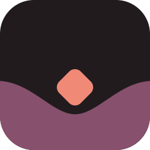
</p>

<h1 align="center">Cindervale</h1>

<p align="center">
  A warm, expressive VS Code theme designed for deep focus.<br>
  <em>Warm color. Deep focus.</em>
</p>

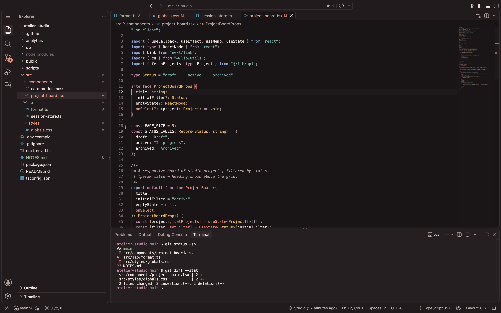

Cindervale is a warm color theme family for Visual Studio Code, built around editorial surfaces and
expressive but restrained syntax highlighting. It comes in four variants that share one visual
language:

| Variant | Palette | For |
| --- | --- | --- |
| **Cindervale Dark** | Warm charcoal and walnut, copper and burgundy light, ivory type | The original dark theme |
| **Cindervale Light** | Warm ivory paper, terracotta and soft wine, sage and muted blue | The original light theme |
| **Cindervale Accessible Dark** | The same charcoal, with violet, sky blue, bronze, peach and teal | Anyone who wants colors that stay apart with protanopia, deuteranopia or tritanopia, and firmer contrast |
| **Cindervale Accessible Light** | The same paper, with deep violet, cobalt, ochre, rust and teal | The same, in light |

Every variant is made for long coding sessions: no neon, no pure black, no pure white.

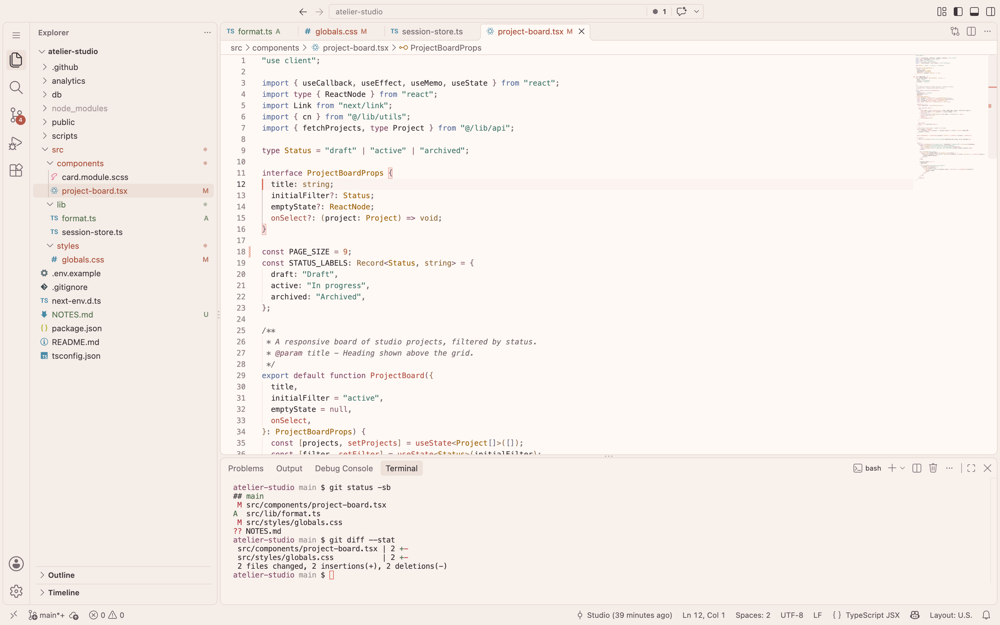

## The accessible variants

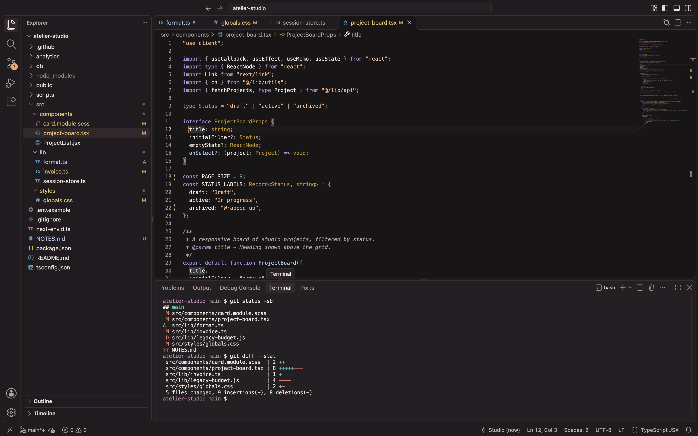

The original palette leans on coral, eucalyptus, berry and sage. Under simulated color vision
deficiencies, several of its roles move very close together: strings and comments, functions and
numbers, and the colors for added, modified and deleted files. **Cindervale Accessible Light** and
**Cindervale Accessible Dark** keep Cindervale's surfaces and neutrals but use a separate set of
colors, chosen and measured so that roles which sit side by side stay apart under simulated
protanopia, deuteranopia and tritanopia:

- **Five syntax accents, separated by lightness as well as hue.** Violet keywords, blue functions,
  ochre types, ember strings, teal numbers. Variables keep the text color, constants are **bold**,
  comments *italic*.
- **One meaning per interface accent.** Blue is focus, information and additions; ochre is find,
  warnings and modifications; berry is errors; ember marks what is active. Red never has to be
  told apart from green.
- **Firmer contrast.** Every syntax color reads at 4.5:1 or more on the editor and the current line,
  line numbers and secondary labels at 4.5:1, and focus rings, input outlines and checkboxes at 3:1.

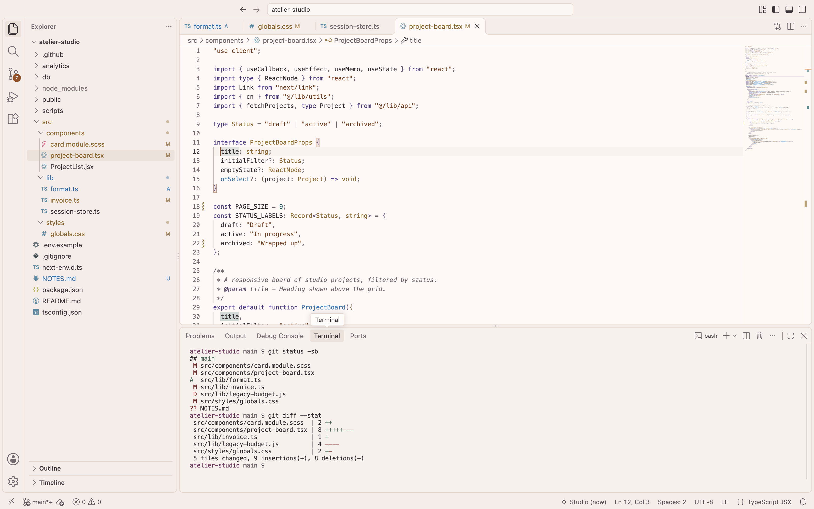

Color vision varies from person to person, and simulations are models, not people: no theme can
promise that every color works for everyone. [docs/accessibility.md](docs/accessibility.md)
describes what was measured, the method, the results (including where the accessible palette is
*closer* than the original) and what still needs testing with people. If something is hard to tell
apart for you, please [open an issue](https://github.com/erenthedeveloper0/cindervale/issues).


## Design

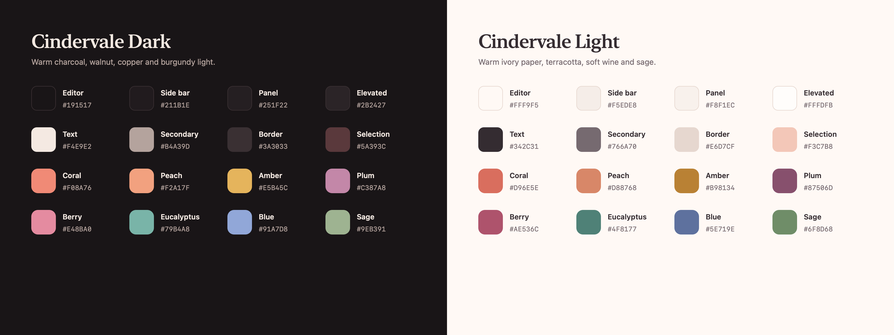

A small set of colors repeats across every language, so a React component, a stylesheet and a
`package.json` all read the same way.

| Color | In code | In the interface |
| --- | --- | --- |
| **Coral** | functions, methods, React components | cursor, focus, badges, primary buttons |
| **Plum** | keywords, tags, JSON and YAML keys, CSS selectors | symbol references |
| **Amber** | types, classes, interfaces, attributes | search matches, warnings |
| **Eucalyptus** | strings, CSS values, inline code | hints |
| **Blue** | `import` / `export`, namespaces, CSS properties, links | information, peek views |
| **Berry** | constants, enums, CSS custom properties | removed lines, breakpoints |
| **Peach** | numbers, booleans, regular expressions | — |
| **Sage** | added lines in diff files | added and untracked files, passing tests |

Comments are set in a warm italic taupe, and punctuation stays quiet so the code itself carries the
page. Editor text measures 15.2:1 contrast in Dark and 13.0:1 in Light.

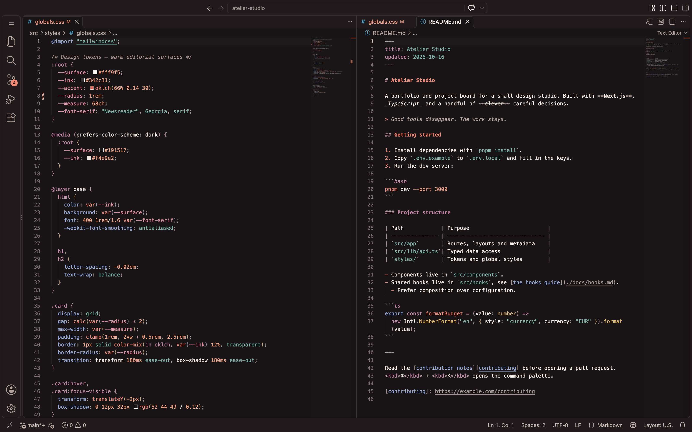

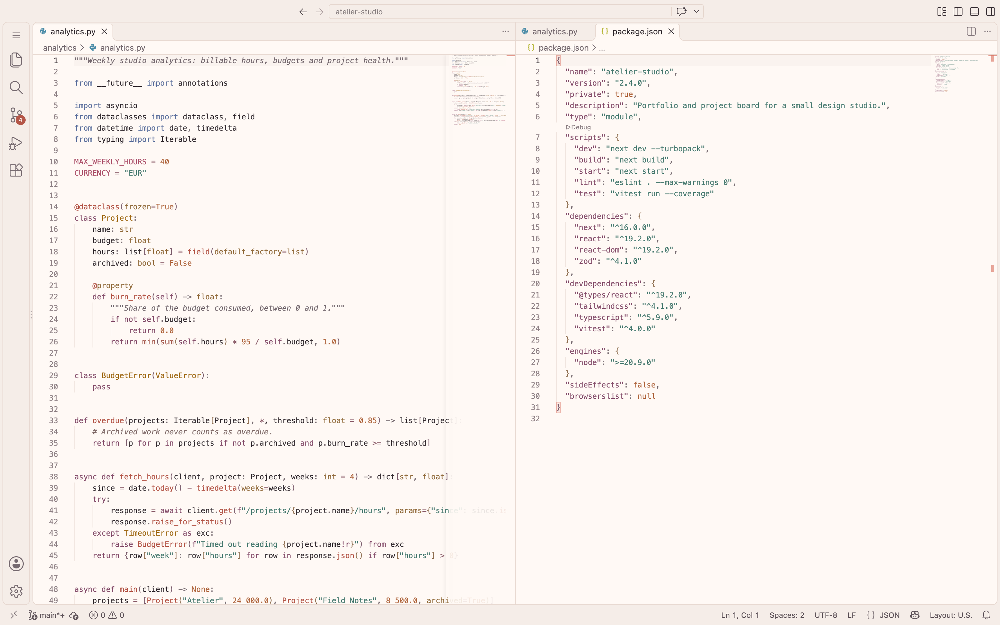

### The accessible palette

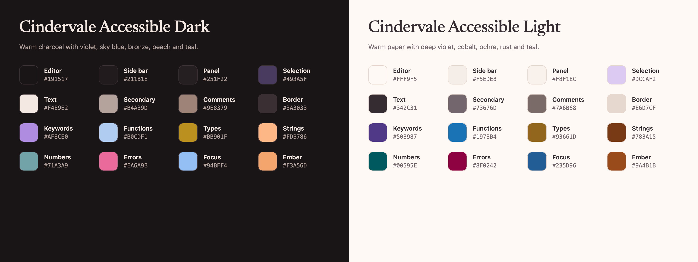

| Role | Accessible Light | Accessible Dark | In the interface |
| --- | --- | --- | --- |
| **Keywords**, tags, keys | deep violet `#503987` | soft violet `#AF8CE0` | selection, debugging |
| **Functions**, methods, components, links in Markdown | blue `#1973B4` | pale blue `#B0CDF1` | information, additions, passing tests |
| **Types**, classes, attributes, Markdown headings | ochre `#93661D` | bronze `#BB901F` | warnings, modifications, find |
| **Strings**, CSS values, inline code | rust `#783A15` | peach `#FDB786` | — |
| **Numbers**, booleans, `null` | deep teal `#00595E` | muted teal `#71A3A9` | hints, symbol references |
| **Constants**, enum members | text, **bold** | text, **bold** | — |
| **Comments** | warm taupe, *italic* | warm taupe, *italic* | — |
| **Errors** | berry `#8F0242` | rose `#EA6A9B` | errors, deleted files |
| **Ember** | `#9A4B1B` | `#F3A56D` | cursor, active tab, buttons, badges |
| **Focus** | `#235D96` | `#94BFF4` | focus rings, links |

Pairs that share a hue family under a color vision deficiency are kept a full lightness tier apart.
In Accessible Light, keywords, strings and numbers are deep tones and functions and types mid tones;
in Accessible Dark, functions and strings are the bright tier and keywords, types and numbers the
softer one. Editor text measures 15.2:1 in Accessible Dark and 13.0:1 in Accessible Light.

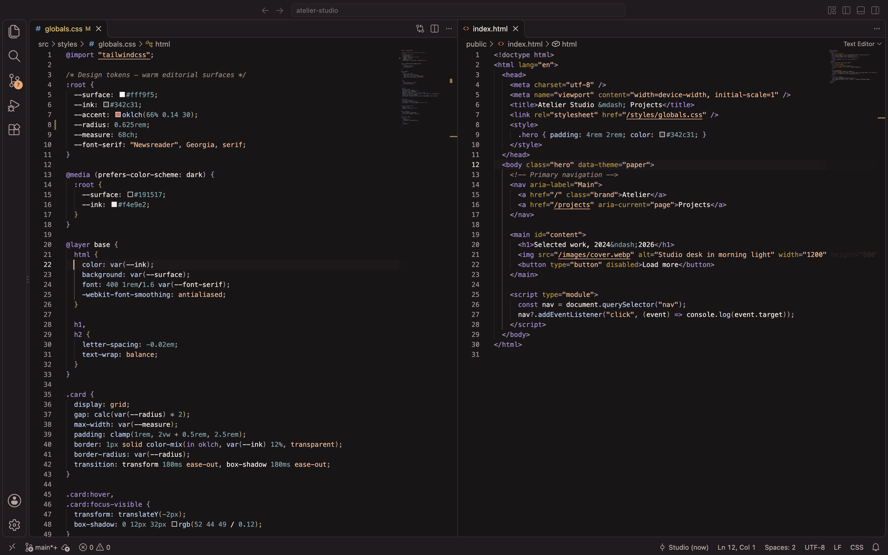

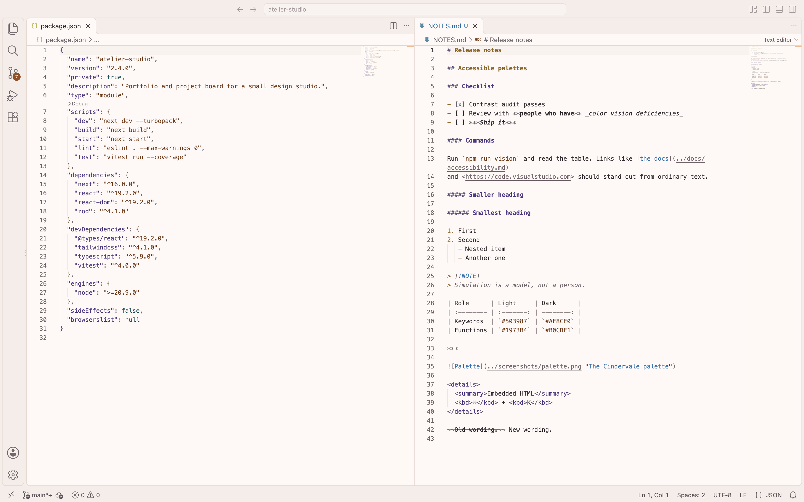

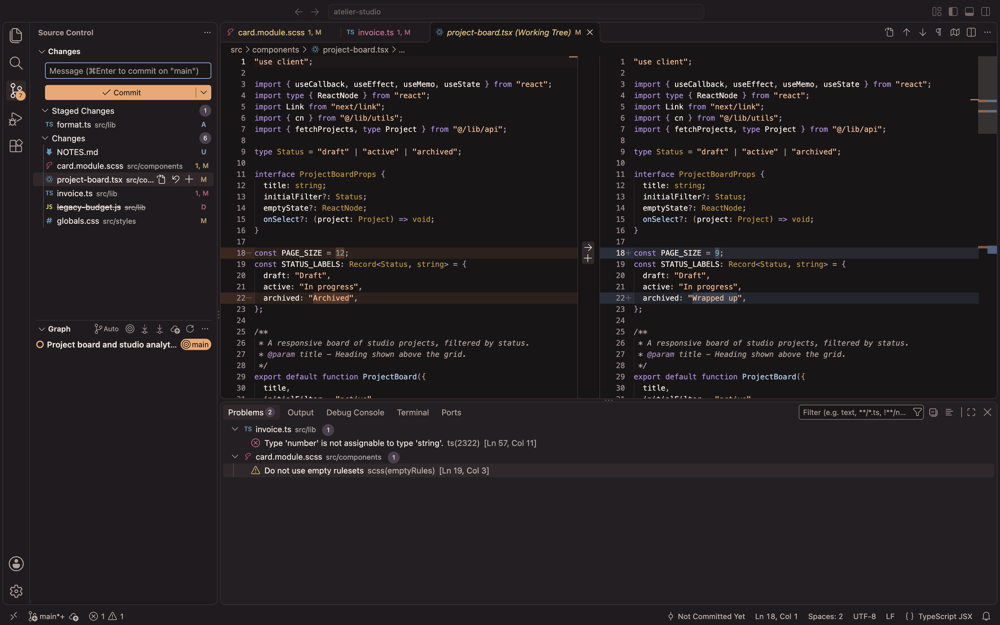

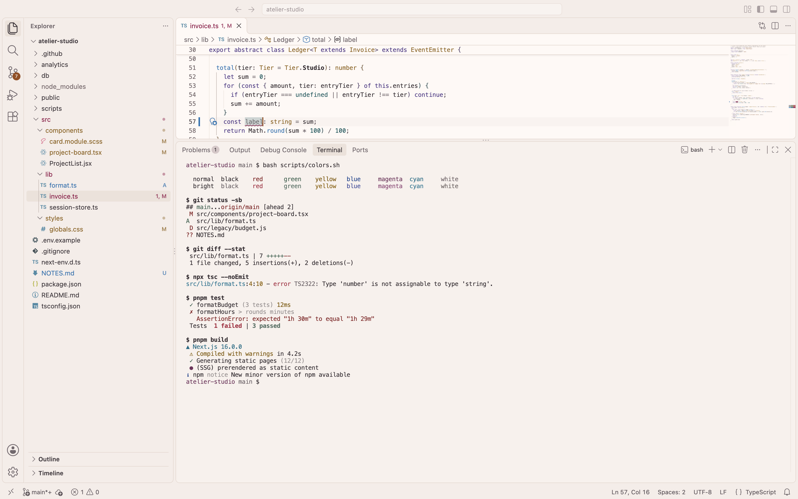

## Features

- Light and dark themes from one palette, plus color-vision-aware Accessible Light and Accessible Dark
- Full workbench styling: side bar, tabs, status bar, command palette, menus, notifications, settings,
  source control, debugging, testing, notebooks and chat
- Semantic highlighting aligned with TextMate colors, so code keeps its color when a language server loads
- Warm 16-color terminal palettes; in the accessible variants, red and green stay apart for
  people with color vision deficiencies
- Git decorations, diagnostics, and diff and merge editor colors
- Bracket pairs, indent guides and a quiet minimap
- Tuned for TypeScript, JavaScript, React, Next.js, HTML, CSS, SCSS, Markdown, JSON, YAML, Python, SQL,
  shell scripts, Go, Rust, Java, C#, C/C++, PHP, Vue and Svelte

## Install

1. Open the Extensions view (<kbd>Ctrl</kbd>/<kbd>Cmd</kbd> + <kbd>Shift</kbd> + <kbd>X</kbd>) and search for **Cindervale**,
   or open [Cindervale on the Visual Studio Marketplace](https://marketplace.visualstudio.com/items?itemName=erenthedeveloper0.cindervale-theme).
2. Select **Install**.
3. Open the theme picker (<kbd>Ctrl</kbd>/<kbd>Cmd</kbd> + <kbd>K</kbd>, then <kbd>Ctrl</kbd>/<kbd>Cmd</kbd> + <kbd>T</kbd>,
   or **Preferences: Color Theme** in the Command Palette) and choose **Cindervale Dark**, **Cindervale Light**,
   **Cindervale Accessible Dark** or **Cindervale Accessible Light**.

Or from a terminal:

```sh
code --install-extension erenthedeveloper0.cindervale-theme
```

The accessible variants are included from version 1.1.0.

To try a build from this repository instead, run `npm install && npm run package` and install the
generated `.vsix` with **Extensions: Install from VSIX…**.

## Recommended settings

Switch between modes with your operating system, and mark modified tabs:

```jsonc
{
  "window.autoDetectColorScheme": true,
  "workbench.preferredDarkColorTheme": "Cindervale Dark",       // or "Cindervale Accessible Dark"
  "workbench.preferredLightColorTheme": "Cindervale Light",     // or "Cindervale Accessible Light"
  "workbench.editor.highlightModifiedTabs": true
}
```

Comments render best with a font that has a true italic, and constants in the accessible variants with
one that has a true bold, such as JetBrains Mono, Cascadia Code or Monaspace. To turn italics off:

```jsonc
"editor.tokenColorCustomizations": {
  "[Cindervale Dark][Cindervale Light][Cindervale Accessible Dark][Cindervale Accessible Light]": {
    "textMateRules": [{ "scope": ["comment", "string.quoted.docstring"], "settings": { "fontStyle": "" } }]
  }
}
```

## Development

The theme files are generated from a palette in `src/` and checked by tests. Node.js 22 or later.

```sh
npm install
npm run build          # regenerate themes/*.json from src/
npm test               # schema, manifest, color IDs, contrast and color-vision checks
npm run contrast       # full contrast report
npm run vision         # full color-vision report
npm run tokens         # check fixture tokens against VS Code's own grammars (needs VS Code)
npm run package:check  # list what the VSIX would contain
npm run package        # build the VSIX
```

[CONTRIBUTING.md](CONTRIBUTING.md) explains how the palette is organized, how to preview changes and
how releases are made.

## Feedback

Found a color that feels off in your language, or two colors you cannot tell apart?
[Open an issue](https://github.com/erenthedeveloper0/cindervale/issues) with a short code sample, a
screenshot and the variant you use.

## License

[MIT](LICENSE) © 2026 Eren SÜMER
