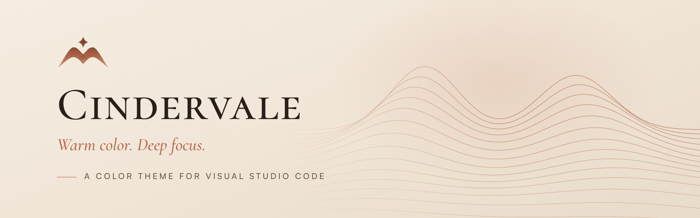

# Cindervale brand

<picture>
  <source media="(prefers-color-scheme: dark)" srcset="social/cindervale-banner-dark.jpg">
  
</picture>

This folder holds Cindervale's identity: the mark, its colors and typefaces, the graphics that go
with it, and every file made from them. It is the brand of the repository and of the Marketplace
listing.

**It is not the theme's palette.** The colors you see in the editor are defined in
[`src/palette.mjs`](../src/palette.mjs) and tuned for reading code: contrast, color vision, long
sessions. The brand colors below are for the logo, banners and images. The two come from the same
warm family, but one is never a substitute for the other.

## The idea

<p align="center">
  
  &nbsp;&nbsp;&nbsp;&nbsp;
  
</p>

A cinder over a vale. The mark is two ridges with a vale between them, and a spark above. In the
editor the vale is the page, and the spark is whatever is active: every variant marks the cursor,
the active tab, badges and primary buttons with a single warm accent.

Four rules follow from it, and every asset obeys them:

1. **One glow.** A composition has at most one soft ember glow, set above the vale. Nothing else
   glows, and the mark never does.
2. **Copper is an accent.** It colors the mark, the tagline and fine rules, never large blocks of
   text or flat panels.
3. **Warm grounds, fine lines.** Walnut and parchment, never pure black or pure white; hairlines and
   quiet separators instead of boxes and shadows.
4. **The product is shown as it is.** Every editor image is a capture of the theme in VS Code. The
   brand frames the screenshots; it never replaces them with mockups.

The voice follows the same idea: warm, never loud; expressive, never distracting; consistent
across every language; built for long sessions.

## Construction

| Element | Rule |
| --- | --- |
| Mark | Two wings drawn with cubic Béziers. Tips at x = ±500, y = 617; ridges at (±191.9, 215.3); the ridges meet at (0, 355.5) and the wings underneath at (0, 552.7). Width to height 1000 : 617. |
| Wings | Each wing is a ribbon of nearly constant depth that tapers to a sharp point. The outer slope rises at about 52°, the inner slope falls at about 46°. |
| Spark | A four-point star with concave sides, 200 wide and 224 tall, centered above the vale. Its lower point reaches the height of the ridges. |
| Fold | Each ridge's inner slope continues under the other wing; their overlap is a diamond, drawn only in the full-color finishes, with a hairline crease along its upper edges. |
| Wordmark | "Cindervale" set in Cormorant SC Medium: a full capital C followed by small capitals, tracked +3.5%. |
| Lockup | The mark beside the wordmark. The mark is 1.9 × the wordmark's font size wide, and the gap is 0.4 × the font size. |
| Icon | The on-dark mark at 64% of a walnut tile with 22% corner radius, a faint ember glow behind the spark, and a hairline edge. |

All geometry lives in [`scripts/brand/identity.mjs`](../scripts/brand/identity.mjs).

## Color

| Token | Hex | Role |
| --- | --- | --- |
| Walnut | `#2B1F1A` | Dark grounds; the mono mark on light |
| Charcoal | `#3B3129` | Raised dark surfaces, rules on dark |
| Ivory | `#F8F6F1` | The mono mark on dark; type on dark |
| Parchment | `#F1E6D8` | Light grounds |
| Copper | `#B8664A` | The mark, the tagline, rules |
| Terracotta | `#C97B5B` | The ember glow |
| Wine | `#7A2E3A` | Reserved for deep accents |
| Eucalyptus · Sage · Blue · Berry | `#6F8F7A` · `#8A9A7B` · `#6B8FB3` · `#9B4F7A` | Secondary: badges and supporting graphics |

The full-color marks are graded from top to bottom across the whole mark, so the spark and the
ridges are the deepest (on light) or brightest (on dark) part:

| Finish | Stops |
| --- | --- |
| Copper, for light grounds | `#7A432E` → `#8A4E35` → `#B0664A` → `#D39A7D` |
| On dark | `#F6E6D6` → `#EFD3BC` → `#D9997A` → `#C27556` |

## Typography

| Use | Typeface | License |
| --- | --- | --- |
| Wordmark | Cormorant SC, 500 | SIL Open Font License 1.1 |
| Display and the tagline | Cormorant Garamond, 500–600 and italic 500 | SIL Open Font License 1.1 |
| Labels, captions, body text in images | Satoshi, 400–700 | ITF Free Font License |
| Code and hex values | JetBrains Mono, 400–500 | SIL Open Font License 1.1 |

The typefaces appear only inside rendered images; no font files are committed. The build loads
them from Google Fonts and Fontshare. In Markdown, GitHub and the Marketplace choose the fonts.

## Graphic language

- **Valley lines.** Fine ridgelines that start from the mark's own profile and open out like
  contours as they descend: lower lines are wider, flatter and further apart. Banners and the social
  preview only.
- **Ember glow.** One soft terracotta glow above the vale, at no more than 20% opacity.
- **Grain.** Fine paper noise at 5–7% opacity over a whole composition, never on the mark itself.
- **Divider.** A copper hairline that fades out at both ends, with the spark at its center. It
  separates the README's sections.

## Usage

- **Clear space:** at least the spark's height on every side of the mark.
- **Minimum size:** full-color finishes from 32 px wide; below that, use a mono finish, which stays
  legible down to 16 px.
- **On light grounds:** the copper mark or the walnut mark. **On dark grounds:** the on-dark mark or
  the ivory mark. **On photographs or mid tones:** mono only.

Don't:

- rotate, mirror, stretch or condense the mark;
- move, resize or remove the spark;
- recolor the gradients or run them in another direction;
- add outlines, shadows or glows to the mark itself;
- put the mark inside another shape, except the icon tile;
- set the wordmark in another typeface, or retype it in all capitals.

## Files

| Path | Use |
| --- | --- |
| `logo/cindervale-mark.svg` | The primary mark, copper, for light grounds |
| `logo/cindervale-mark-on-dark.svg` | The full-color mark for dark grounds |
| `logo/cindervale-mark-walnut.svg` · `-ivory.svg` · `-currentcolor.svg` | Mono marks |
| `logo/cindervale-lockup-on-light.png` · `-on-dark.png` | Mark and wordmark on a transparent ground, 1120 × 240 |
| `social/cindervale-banner-light.jpg` · `-dark.jpg` | README header, 2560 × 800 |
| `social/cindervale-social-preview.jpg` | GitHub social preview, 1280 × 640 |
| `graphics/cindervale-divider.png` | README section divider on a transparent ground, 1760 × 32 |
| [`../images/icon.svg`](../images/icon.svg) · `icon.png` | The Marketplace and VS Code icon, 256 px. It lives beside the manifest that names it |

The README uses PNG and JPEG rather than SVG on purpose: the README is also the Marketplace page,
and `vsce` refuses SVG images there. For the same reason its `<picture>` sources are absolute URLs
to the `main` branch: `vsce` rewrites relative `` sources for the Marketplace, but not
`srcset`. Each `` fallback reads on any background, because VS Code drops `<picture>` when it
shows the README. The palette sheets and color-vision boards in
[`screenshots/`](../screenshots) are set in the same typefaces by
[`scripts/screenshots/boards.mjs`](../scripts/screenshots/boards.mjs).

## Rebuild

Every file above is generated by [`scripts/brand/build.mjs`](../scripts/brand/build.mjs). Edit the
identity, then rebuild; never edit an export by hand.

```sh
npm run brand            # everything: SVGs, the icon, lockups, banners, social preview, divider
npm run brand -- --svg   # the SVG files only (no browser, no network)
```

Rasters are rendered by a headless Chromium-based browser (set `CHROME` if none is found) and need a
network connection for the typefaces. The social preview includes real captures from
`screenshots/`, so rebuild it after `npm run screenshots`.

## Licensing

The artwork, the build scripts and these guidelines are MIT-licensed with the rest of the
repository. Cormorant SC, Cormorant Garamond and JetBrains Mono are licensed under the SIL Open Font
License 1.1, and Satoshi under the ITF Free Font License; each permits rendering the typeface into
images, and none of them is redistributed here.

The icon used from 1.0.0 to 1.1.0, a coral ember resting in a plum valley, is in the git history.
