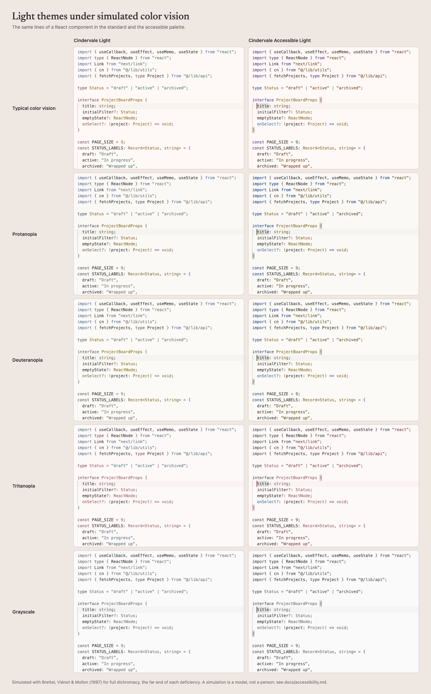
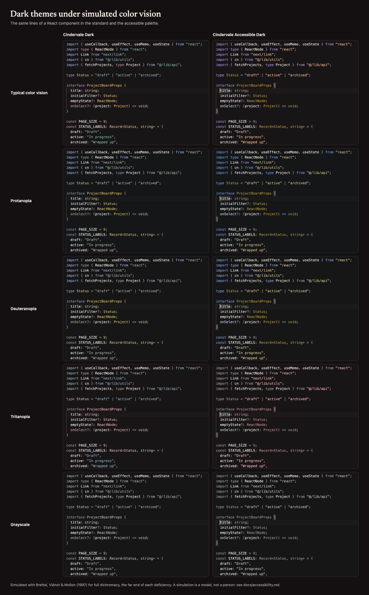

# Accessibility in Cindervale

Cindervale ships two families of themes:

- **Cindervale Light** and **Cindervale Dark**, the original palette: coral, plum, amber,
  eucalyptus, berry, peach, blue and sage.
- **Cindervale Accessible Light** and **Cindervale Accessible Dark**, which keep Cindervale's warm
  surfaces and neutrals but use a separate set of syntax and interface colors. The goal is to keep
  colors that carry meaning apart for people with protanopia, deuteranopia or tritanopia, and to
  give every text and control a measured contrast floor.

This document records how the accessible variants were designed and tested, what was measured,
and what still needs human verification. The figures come from the scripts in this repository and
can be regenerated with the commands under [Reproducing the results](#reproducing-the-results).

> **What this is not.** The accessible variants were built against the contrast and
> color-distinction targets described below. That is engineering practice, not a WCAG conformance
> claim: conformance applies to content and products, not to a color theme on its own, and
> simulations are models of color vision, not people. No color theme can guarantee that every
> color is distinguishable for everyone. Color vision varies widely, as do monitors, ambient light
> and personal preference.

## Contents

1. [Design principles](#design-principles)
2. [The palette](#the-palette)
3. [Where the palette moved from the starting values](#where-the-palette-moved-from-the-starting-values)
4. [Color vision deficiencies considered](#color-vision-deficiencies-considered)
5. [Contrast audit](#contrast-audit)
6. [Color-vision audit](#color-vision-audit)
7. [Grayscale review](#grayscale-review)
8. [What does not depend on color](#what-does-not-depend-on-color)
9. [Fixtures and semantic highlighting](#fixtures-and-semantic-highlighting)
10. [Test results](#test-results)
11. [Visual QA](#visual-qa)
12. [Limitations and what needs human verification](#limitations-and-what-needs-human-verification)
13. [Reporting an accessibility issue](#reporting-an-accessibility-issue)
14. [Rules for future color changes](#rules-for-future-color-changes)
15. [Reproducing the results](#reproducing-the-results)

## Design principles

1. **Hue and lightness together.** Under protanopia and deuteranopia, color collapses onto
   roughly one blue↔yellow axis plus lightness; under tritanopia, onto a red↔teal axis plus
   lightness. Two roles that land on the same side of that axis must differ in lightness, so the
   syntax colors are arranged in lightness tiers as well as hues.
2. **One meaning per accent.** Across the interface, blue means focus, information and additions;
   ochre means find, warnings and modifications; berry means errors; vermillion tints mark removed
   text; ember marks whatever is active. Red and green never carry a distinction on their own.
3. **Fewer syntax colors, held firmly.** Five accents carry the code: violet keywords, blue
   functions, ochre types, ember strings and teal numbers. Variables stay in the text color;
   constants keep the text color and are set in **bold**; comments are a muted warm neutral in
   *italic*. Operators and punctuation stay neutral.
4. **Cindervale's surfaces.** The editor is warm paper (`#FFF9F5`) or warm charcoal (`#191517`),
   never pure white or black, with the side bar, panel and widgets a step apart.
5. **Measured, not assumed.** Every claim below is backed by a script that fails when a target is
   missed.

## The palette

The source of truth is `accessibleSource` in [`src/palette.mjs`](../src/palette.mjs); the theme
JSON is generated from it (`npm run build`). Contrast is against the editor background.

| Role | Light | Contrast | Dark | Contrast |
| --- | --- | --: | --- | --: |
| Text, variables | `#342C31` | 12.98 | `#F4E9E2` | 15.16 |
| Keywords, tags, keys | `#503987` deep violet | 8.84 | `#AF8CE0` soft violet | 6.59 |
| Functions, methods, components | `#1973B4` blue | 4.85 | `#B0CDF1` pale blue | 11.07 |
| Types, classes, attributes | `#93661D` ochre | 4.84 | `#BB901F` bronze | 6.13 |
| Strings, CSS values, inline code | `#783A15` rust | 8.33 | `#FDB786` peach | 10.59 |
| Numbers, booleans, `null` | `#00595E` deep teal | 7.77 | `#71A3A9` muted teal | 6.47 |
| Constants, enum members | text color, **bold** | 12.98 | text color, **bold** | 15.16 |
| Comments | `#7A6B68` *italic* | 4.87 | `#9E8379` *italic* | 5.15 |
| Operators, doc comments | `#73676D` | 5.17 | `#B4A39D` | 7.46 |
| Errors | `#8F0242` berry | 8.92 | `#EA6A9B` rose | 6.06 |
| Warnings, modified files | `#906319` ochre | 5.05 | `#E7C16D` gold | 10.55 |
| Information, added files | `#1571B1` blue | 4.99 | `#B0CDF1` pale blue | 11.07 |
| Hints, renamed files | `#00595E` teal | 7.77 | `#71A3A9` teal | 6.47 |
| Focus rings, links | `#235D96` | 6.54 | `#94BFF4` | 9.49 |
| Ember: cursor, active marks, buttons | `#9A4B1B` | 5.92 | `#F3A56D` | 8.97 |
| Selection | `#DCCAF2` lavender | — | `#493A5F` dusk violet | — |

In the light theme, warning, information and Git labels are inked a touch deeper than the syntax
tones so they also clear 4.5:1 on the side bar, which is darker than the editor.

**Constants.** Bold applies only to true constants: `ALL_CAPS` names, `const` items in Rust,
enum members, and Rust's `Some`/`None`/`Ok`/`Err`. TypeScript's grammar gives every `const`
*declaration* the same scope as an `ALL_CAPS` reference, so declarations are reset to regular
weight; otherwise most names in modern code would be bold. As a consequence an `ALL_CAPS` name is
regular where it is declared and bold where it is used, and all-caps globals such as `JSON` are
bold too. TypeScript's semantic `readonly` modifier is deliberately not styled: TypeScript marks
every `const` binding as readonly, so it cannot separate constants from ordinary variables.

**Same color, different syntax.** Function declarations and calls, classes and interfaces, and
parameters and properties share a color. Their keywords and positions already tell them apart,
and every extra hue would make the remaining ones harder to separate.

## Where the palette moved from the starting values

The design started from a specified palette. Measuring it showed collisions, so several values
moved. Each change was the smallest that met the targets below.

| Role | Started as | Final | Why |
| --- | --- | --- | --- |
| Light keywords | `#6F469D` | `#503987` | Violet and blue merged under deuteranopia (ΔE₀₀ 1.2) and protanopia (4.5). Keywords moved a lightness tier darker. |
| Light functions | `#235D96` | `#1973B4` | The other half of the same fix: functions moved a tier lighter. The starting blue stays as the focus and link color. |
| Light types | `#855800` | `#93661D` | Ochre and burnt orange merged under deuteranopia (1.7). Types moved lighter, strings darker. |
| Light strings | `#9A4B1B` | `#783A15` | See types. The starting value stays as the ember accent. |
| Light numbers | `#006F79` | `#00595E` | Blue and teal merged under tritanopia (3.2). Numbers moved a tier darker. |
| Dark keywords | `#C5A8F0` | `#AF8CE0` | Violet and blue merged under deuteranopia (0.9). |
| Dark functions | `#94BFF4` | `#B0CDF1` | Same fix; the starting blue stays as the focus and link color. |
| Dark types | `#E7C16D` | `#BB901F` | Separating types from strings: bronze types, bright peach strings. The starting gold stays as the warning color. |
| Dark strings | `#F3A56D` | `#FDB786` | See types. The starting value stays as the ember accent. |
| Dark numbers | `#7DC9D2` | `#71A3A9` | Blue and teal merged under tritanopia (2.0). |
| Errors | `#8B3159` / `#F08CB4` | `#8F0242` / `#EA6A9B` | Errors and warnings were 7.5 apart under tritanopia (light). The error moved deeper. |
| Light secondary text | `#766A70` | `#73676D` | Measured 4.47:1 on the side bar; now 4.67:1. |
| Light disabled text | `#857478` | `#79686C` | Line numbers, placeholders and unfocused tabs are mixed from secondary and disabled; all now clear 4.5:1. |
| Light selection | `#E1D2F0` | `#DCCAF2` | Was 7.3 from the page under tritanopia; now 8.8, with every token still ≥ 3:1 on it. |
| Deletion tints | berry | vermillion `#C2541A` / `#E07A45` | Berry turns slate blue under protanopia and merged with the blue addition tints (ΔE₀₀ 2.2). |
| Find highlight | ochre / gold | `#D9AB45` / `#A07A2A` behind text | The starting tones lowered comments on a match to 2.0–2.8:1. Tints behind text now lean toward the page. |
| Hint dots | 80% opacity | full strength | Translucent teal drifted into the information blue under tritanopia (3.6). |

## Color vision deficiencies considered

| Condition | What it changes | How it was tested |
| --- | --- | --- |
| Protanopia, protanomaly | Red-sensitive cones absent or shifted: reds darken, red and green converge | Full protanopia simulation (the far end of protanomaly) |
| Deuteranopia, deuteranomaly | Green-sensitive cones absent or shifted: red and green converge | Full deuteranopia simulation |
| Tritanopia, tritanomaly | Blue-sensitive cones absent or shifted: blue and green converge, yellow turns pink | Full tritanopia simulation |
| Achromatopsia, or a grayscale display | No hue at all | Luminance-only rendering, reported as a stress test |
| Reduced contrast sensitivity | Low-contrast text and outlines fade | Contrast floors above WCAG AA for primary text (7:1) and on overlays |

Red–green deficiencies are the most common, so they received the most attention; tritan
deficiencies were tested with the same rigor. The anomalous trichromacies are milder forms of the
dichromacies on the same confusion axes. Simulating full dichromacy tests the far end of each.

## Contrast audit

`npm run contrast` measures every foreground against the surface it actually appears on, using
the WCAG 2 relative-luminance formula. Translucent overlays (find matches, diff lines, selection
highlights) are composited onto the editor first, and translucent foregrounds onto the result.
Pairs are defined in [`test/contrast-pairs.mjs`](../test/contrast-pairs.mjs).

**Targets for the accessible variants**

| What | Target |
| --- | --- |
| Editor text, side bar text, menus, widgets, selected rows | 7:1 |
| Every syntax role on the editor and on the current line | 4.5:1 |
| Secondary labels, line numbers, placeholders, code lens, inlay hints, links, Git labels | 4.5:1 |
| Text on find matches, symbol references, diff and merge tints | 7:1 |
| Syntax on the selection | 3:1 (comments and punctuation 2.8:1) |
| Strings and comments on overlays | 3.5:1 and 3:1 |
| Focus rings, input, checkbox and dropdown outlines, active tab and panel marks, squiggles, gutter bars, cursor | 3:1 (non-text) |
| Disabled text | 3:1 |

**Results** (all pairs with a target pass in all four themes)

| Theme | Pairs measured | Pass | Fail | Measured without a target |
| --- | --: | --: | --: | --: |
| Cindervale Accessible Light | 222 | 222 | 0 | 0 |
| Cindervale Accessible Dark | 223 | 223 | 0 | 0 |
| Cindervale Light | 222 | 137 | 0 | 85 |
| Cindervale Dark | 223 | 138 | 0 | 85 |

The smallest margins in the accessible variants are the light theme's Git *added* and
*untracked* labels (4.51:1 against 4.5) and inlay hints (4.54:1). The lowest ratios are syntax on
the selection (types, primitive types and attributes at 3.31:1 in light, against 3) and comments on
the selection (2.91:1 in dark, against 2.8), which is the nature of a visible selection; text on
the selection is 8.88:1 and 8.57:1.

**The standard themes against the accessible targets.** The standard themes are held to the
floors they were designed with (in `test/contrast-pairs.mjs`). Measured against the stricter
accessible targets, Cindervale Light misses 52 pairs and Cindervale Dark 11. These are
measurements, not regressions. For example:

| Standard theme pair | Measured | Accessible target |
| --- | --: | --: |
| Light: focus ring on the side bar | 2.86:1 | 3:1 |
| Light: links on the side bar | 4.19:1 | 4.5:1 |
| Light: line numbers | 3.42:1 | 4.5:1 |
| Light and Dark: input outlines | 1.38:1 and 1.39:1 | 3:1 |
| Dark: comments on a find match | 2.34:1 | 3:1 |

They are recorded here for a future release of the standard themes. 1.1.0 leaves the published
standard themes unchanged.

## Color-vision audit

`npm run vision` simulates each color under protanopia, deuteranopia and tritanopia and measures
how far apart paired roles remain, using:

- **Simulation:** Brettel, Viénot & Mollon (1997), in linear sRGB, with the parameters of the
  DaltonLens reference implementation ([`src/vision.mjs`](../src/vision.mjs)). Unit tests check
  that neutrals stay neutral and that the classic confusions appear.
- **Difference:** CIEDE2000 (ΔE₀₀), verified against Sharma, Wu & Dalal's published test data.
- **Targets** (engineering choices for this theme, not a standard): adjacent syntax roles ≥ 15 in
  typical vision and ≥ 10 under each simulated dichromacy (≥ 8 when one side is an italic
  comment); errors vs warnings ≥ 20 / 15; Git states ≥ 15 / 10; diff tints, which cover large
  areas, ≥ 6 / 4 for lines and ≥ 10 / 7 for changed words; the terminal's red vs green ≥ 20 / 12.
  For scale, ΔE₀₀ ≈ 1 is a just-noticeable difference for large patches; thin glyphs need far
  more to read as different categories at a glance.

All 59 pairs in each accessible variant meet their targets. The table compares the standard and
accessible themes: each cell is *typical ΔE₀₀ · worst simulated ΔE₀₀* with the deficiency that
produced the worst case (P protanopia, D deuteranopia, T tritanopia).

| Pair | Light | Accessible Light | Dark | Accessible Dark |
| --- | --- | --- | --- | --- |
| Keywords / functions | 20.4 · 10.9 T | 25.8 · 12.7 D | 21.3 · 10.1 T | 19.3 · 13.0 D |
| Functions / types | 22.0 · **5.4** T | 45.3 · 46.2 T | 26.0 · **8.5** D | 43.5 · 38.8 T |
| Types / strings | 33.9 · 21.1 P | 17.6 · 13.0 D | 32.5 · 21.0 P | 20.5 · 13.7 T |
| Functions / numbers | 10.0 · **3.8** D | 22.6 · 12.6 T | 7.7 · **3.6** D | 19.5 · 13.5 T |
| Strings / numbers | 37.5 · 15.3 P | 38.4 · 24.6 P | 39.2 · 12.8 P | 36.7 · 26.1 P |
| Comments / strings | 30.8 · **2.5** P | 21.8 · 19.6 T | 32.4 · 9.5 D | 22.4 · 20.7 T |
| Errors / warnings | 30.0 · **8.9** D | 40.6 · 16.9 T | 34.4 · 12.4 D | 48.0 · 17.4 T |
| Information / hints | 25.8 · 10.0 T | 22.1 · 11.6 T | 25.3 · 9.0 T | 19.5 · 13.5 T |
| Git added / modified | 39.1 · **5.8** P | 45.2 · 45.8 T | 34.5 · **4.5** P | 42.5 · 35.0 T |
| Git added / deleted | 46.5 · **6.5** D | 45.3 · 24.8 P | 41.9 · **5.0** D | 38.4 · 21.9 D |
| Git modified / deleted | 16.9 · **1.0** T | 40.6 · 16.9 T | 17.0 · **3.1** T | 48.0 · 17.4 T |
| Diff: inserted / removed line | 8.1 · **1.1** D | 10.3 · 7.0 P | 8.9 · **1.6** D | 11.3 · 9.5 P |
| Diff: inserted / removed words | 15.7 · **2.9** D | 20.8 · 15.9 P | 17.8 · **2.2** D | 19.4 · 16.3 P |
| Selection / editor | 15.9 · 12.0 P | 19.7 · 8.8 T | 18.6 · 12.8 P | 20.6 · 13.9 T |
| Find match / selection | 11.4 · **3.3** D | 32.8 · 10.2 T | 19.5 · **6.6** T | 31.0 · 10.7 T |
| Terminal red / green | 47.5 · **7.7** D | 45.7 · 15.9 D | 42.7 · **6.7** D | 58.8 · 16.0 P |

Bold marks standard-theme values below the accessible targets. Across all syntax pairs, the
closest worst case is 1.9 (Light) and 3.4 (Dark) in the standard themes, against 12.0 and 9.0 in
the accessible ones. The 9.0 is comments vs types under tritanopia, a pair whose target is 8
because comments are also italic.

Some pairs are *closer* in the accessible palette than in the standard one. Types vs strings is
the clearest case: ochre and rust are both warm, so their separation comes from lightness alone.
That is the price of separating violet from blue and blue from teal, and the pair still clears
its target.

The boards below show the same lines of a React component, captured in VS Code and run through
the same simulation pixel by pixel ([`scripts/screenshots`](../scripts/screenshots)).





## Grayscale review

With hue removed entirely, five accents plus text cannot all be told apart by lightness: the
light theme has room for tokens only between the text (L\* 19) and the 4.5:1 limit (L\* ≈ 50).
In grayscale the accessible variants keep these distinctions:

- text vs every accent (the closest is keywords in dark at 20.1 ΔE₀₀, and strings in light at 9.5),
- comments, by *italic*, and constants, by **bold**,
- keywords vs functions (14.4 light, 12.7 dark), and types vs strings (13.0 light, 13.6 dark),
- errors vs warnings (13.2 light, 13.9 dark).

These pairs become indistinguishable in grayscale: functions vs types (0.0 light), keywords vs
types (1.9 dark), keywords vs numbers (0.3 dark), and strings vs numbers (1.7 light). People who
see no hue at all will rely on structure, italics and weight for those pairs. The grayscale row of
the boards above shows this.

## What does not depend on color

A color theme cannot add icons or labels, but VS Code already provides cues that do not depend on
color, and the accessible variants keep them strong:

- **Explorer and Source Control:** files carry `A`, `M`, `D`, `U`, `R` and `!` letters next to
  their colored names; deleted files are struck through in Source Control.
- **Gutter:** added lines are solid bars, modified lines hatched bars, deletions a wedge.
- **Diff editor:** `+` and `−` markers in the gutter, and side-by-side layout.
- **Diagnostics:** errors, warnings and information use different icons in the Problems panel and
  hovers; hints are dots, not squiggles.
- **Find:** the current match has a solid border; other matches do not.
- **Focus:** solid 3:1 focus rings (the standard themes use translucent ones).
- **Tabs:** the active tab has an ember top border and full-contrast text; modified tabs show a dot.
- **Syntax:** comments are italic, constants bold, headings in Markdown bold.

## Fixtures and semantic highlighting

[`fixtures/`](../fixtures) contains realistic sample files: TypeScript (`session-store.ts`,
`theme-tour.ts`), TSX (`project-board.tsx`), JavaScript (`studio-client.js`), JSX
(`ProjectList.jsx`), HTML, CSS, SCSS, Python, Rust, Go, Java, C#, C++, SQL, JSON, JSONC, YAML,
Markdown (`README.md`, `NOTES.md`), shell, PHP, Vue, Svelte, dotenv, a unified diff, and
`terminal-colors.sh`, which prints the ANSI palette and typical Git, compiler, test and build output.

- **TextMate coloring** is checked automatically. `npm run tokens` tokenizes the fixtures with the
  TextMate engine and grammars of a local VS Code (the same code VS Code runs) and asserts that
  65 real tokens resolve to their intended role and font style in every theme they apply to: 254
  checks in all. CI runs it against the latest stable VS Code.
- **Semantic fallback.** When a semantic token's style leaves a property unset, VS Code fills it
  from TextMate rules matched against a bare *probe* scope; `variable.readonly`, for example, probes
  `variable.other.constant`. Because TypeScript marks every `const` binding readonly, an early build
  made most variables bold once the language server attached. TextMate-only checks could not see
  it; the live screenshots did. The weighted rules are now anchored under `source`, which real
  tokens always have and probes never do, and a test replays VS Code's probe table to make sure
  no probe can resolve to bold again.
- **Semantic highlighting for TypeScript and JavaScript** uses VS Code's built-in language
  service. It is active in the screenshots, which were captured after the TypeScript server
  started. The rules mirror the TextMate colors, so tokens keep their color when it attaches.
- **Semantic highlighting for other languages** (Pylance for Python, rust-analyzer, clangd, the
  Java and C# extensions) is styled by the same rules but **was not tested**: those extensions
  were not installed in the test profile.

## Test results

| Test | Method | Expected | Actual | Status | Notes |
| --- | --- | --- | --- | --- | --- |
| Generated themes match source | `npm run check` | All four JSON files identical to `src/` output | 4 of 4 up to date | Pass | |
| Theme schema, manifest and registration | `npm test` | Every test passes | 54 of 54 | Pass | Includes unique names, the original registrations, all 16 ANSI colors, valid hex and font styles, no scope in two rules, and no bold through semantic probes |
| Workbench color IDs | `npm test` and `npm run colors:sync -- --check` | Every key registered by VS Code | 0 unknown keys in 4 themes (VS Code 1.143.1, 994 IDs) | Pass | |
| Contrast | `npm run contrast` | Every pair with a target meets it | 890 pairs measured; 0 failures | Pass | See [Contrast audit](#contrast-audit) |
| Color-vision separation | `npm run vision` | Every pair meets its targets in both accessible themes | 59 of 59 in each | Pass | Simulation, not people |
| CIEDE2000 and simulation math | `npm test` | Matches published data; neutrals stay neutral | 8 of 8 Sharma pairs within 10⁻⁴ | Pass | |
| TextMate token roles | `npm run tokens` | Each fixture token resolves to its role and style | 254 of 254 | Pass | VS Code 1.143.1 grammars |
| Grayscale | `npm run vision` (gray column) | Reported, not enforced | See [Grayscale review](#grayscale-review) | Reported | Some pairs merge by design |
| Screenshot simulation | `npm run screenshots` | Boards render from real captures | `color-vision-light.png` and `color-vision-dark.png` built from VS Code 1.143.1 captures of all four themes | Pass | Same model as the audit |
| Visual QA in VS Code | Captures of the packaged extension reviewed by eye | No unreadable text, lost borders or merged states | See [Visual QA](#visual-qa) | Pass after fixes | Four defects found and fixed |
| Package contents | `npm run package:check` | Four themes and Marketplace files; nothing from development | 9 files | Pass | |
| Testing with people who have CVD | Not done | — | — | Not run | Needs volunteers; see below |

## Visual QA

The screenshots come from VS Code 1.143.1 on macOS with the packaged VSIX installed in a clean
profile (`npm run screenshots`). The TypeScript server was running, so TS/TSX captures include
semantic highlighting. These captures were reviewed by eye:

| Scene | Accessible Light | Accessible Dark |
| --- | :-: | :-: |
| TSX, Explorer with Git decorations, terminal with `git status` and `git diff --stat` | ✓ | ✓ |
| CSS beside HTML (selectors, properties, values, tags, attributes, entities, embedded script) | ✓ | ✓ |
| JSON beside Markdown (keys, literals, H1–H6, links, inline code, quotes, tables, task lists) | ✓ | ✓ |
| Source Control, side-by-side diff with word changes, Problems with an error and a warning | ✓ | ✓ |
| Error squiggle in TypeScript and the full ANSI palette with Git, compiler, test and build output | ✓ | ✓ |
| Command Palette with match highlights | | ✓ |
| Selection across several token colors | ✓ | |
| Find widget, current match and other matches | | ✓ |
| Suggestion list | ✓ | ✓ |
| Hover card | | ✓ |
| Settings editor (inputs, checkbox, dropdowns, focus ring, primary button) | ✓ | |

The review found four defects that the automated checks had not caught; all are fixed:

1. Most `const` bindings turned bold once the TypeScript server attached (see
   [semantic fallback](#fixtures-and-semantic-highlighting)). It is now covered by a test.
2. The captures ran in an Extension Development Host, whose title differs from what users see.
   They now install the packaged VSIX.
3. A deliberate CSS warning leaked into the main screenshot. It moved to the diagnostics scene.
4. The terminal palette scrolled out of view, and the palette sheet rendered in tiles. The
   capture scripts were corrected.

Not reviewed in a live session: debugging (paused line, breakpoints, inline values, debug
toolbar), the merge editor, notebooks, the testing view and the Extensions view. Their colors are
covered by the contrast audit only.

## Limitations and what needs human verification

- **Simulation is not perception.** The Brettel model approximates dichromacy for an average
  observer on an sRGB display. Anomalous trichromacy, cone variation, display calibration, glare
  and font rendering all change what people actually see. Feedback from people with color vision
  deficiencies is the test that matters, and it has not happened yet.
- **Small text.** ΔE₀₀ is defined for patches. Thin glyphs at 12–14 px look less colorful than
  their swatches, which is why the targets here are far above a just-noticeable difference.
- **Untested environments:** semantic highlighting from third-party language servers; high
  contrast OS modes (VS Code uses its own high-contrast themes there); Windows and Linux font
  rendering; the debugger's paused state, breakpoints and inline values, which have contrast
  checks but were not inspected in a live debugging session.
- **Terminal programs choose their own colors.** The palette keeps red apart from green, but a
  program that prints "success" and "failure" only as green and red text still relies on color.
  VS Code's `terminal.integrated.minimumContrastRatio` setting (4.5 by default) can further adjust
  low-contrast output; the accessible ANSI colors already meet 4.5:1, so it does not need to.
- **Extensions and webviews** (Markdown preview styles, notebooks' rich output, other extensions'
  decorations) draw some colors themselves.

## Reporting an accessibility issue

Please [open an issue](https://github.com/erenthedeveloper0/cindervale/issues) with:

1. The theme (for example *Cindervale Accessible Dark*) and VS Code version.
2. A screenshot and a short code sample, or the part of the interface involved.
3. What is hard to tell apart or read, and, if you are comfortable sharing it, the kind of color
   vision you have. Feedback from people who see color differently is especially welcome.

## Rules for future color changes

1. Change colors in `src/palette.mjs`, never in `themes/*.json`, and run `npm run build`.
2. `npm test` must pass: it includes the contrast and color-vision audits. Do not lower a target
   to make a change pass. If a target is wrong, change it in its own commit and explain why.
3. Run `npm run tokens` when touching `src/syntax.mjs`, and add an expectation for any new rule.
4. Run `npm run vision` and include the closest-pair line for both accessible themes in the pull
   request.
5. Keep the five-accent syntax system. A new syntax color must be measured against every
   existing role, under every simulation.
6. Keep red vs green out of any distinction the theme controls.
7. Update this document and the palette table in the README when a value in it changes.

## Reproducing the results

```sh
npm install
npm run build            # regenerate themes/*.json
npm test                 # schema, manifest, color IDs, contrast and color-vision checks
npm run contrast         # full contrast report (add --json reports/contrast.json)
npm run vision           # full color-vision report (add --json reports/vision.json)
npm run tokens           # fixture tokens vs. VS Code's grammars (needs a local VS Code)
npm run colors:sync      # refresh the registered color IDs from a local VS Code
npm run screenshots      # recapture screenshots and boards (opens a VS Code window)
```

To simulate any screenshot yourself:

```sh
node scripts/screenshots/simulate.mjs screenshots/cindervale-accessible-dark.png out/
```

For an independent check, the same images can be inspected with tools that use other models, for
example [Color Oracle](https://colororacle.org) (full-screen, desktop) or the color-vision
emulation in Chrome and Edge DevTools (Rendering → *Emulate vision deficiencies*).
